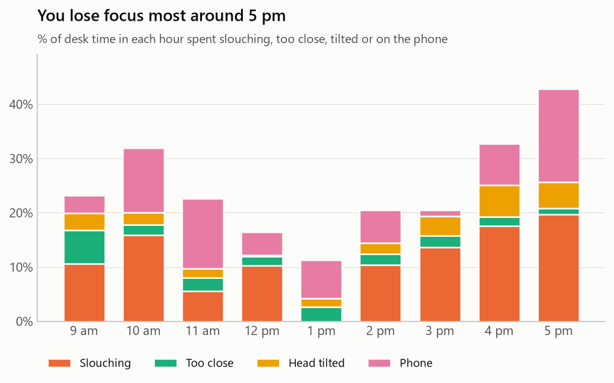
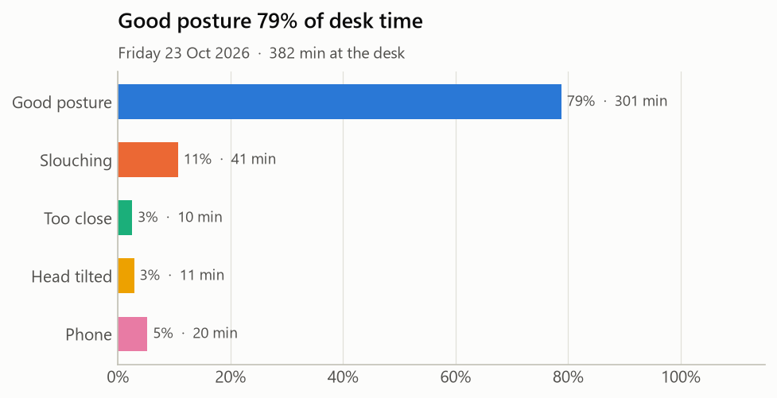
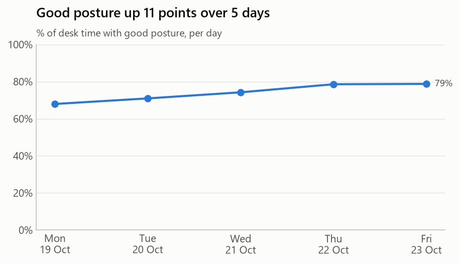

# Focus Coach

[](https://github.com/SangitaZare/focus-coach/actions/workflows/tests.yml)


A webcam app that watches how you sit while you work and nudges you when you:

- **slouch** (your head sinks towards your shoulders)
- **lean too close** to the screen
- **tilt your head** (e.g. resting it on your hand)
- **pick up your phone**
- **sit too long** without a break (50 minutes by default)

Optional **Pomodoro mode** that uses the camera to keep you honest (see below).

Every second is saved to a CSV file on your own computer, so you can see
your habits over days and weeks. Nothing is uploaded anywhere.

## The problem it solves

People who work at a computer for hours slowly slouch and lean in without
noticing, which leads to neck pain, back pain and eye strain. Phones quietly
break focus: "just one second" becomes twenty minutes. Most people never fix
these habits because nothing measures them. Focus Coach measures them, warns
you in the moment, and keeps a record.

## How it works

```
webcam frame ─► detector.py ─► posture.py ─► coach.py ─► storage.py
               what is there   good or bad?  alert now?   save to CSV
```

| File | Job |
|---|---|
| `detector.py` | Runs two pre-trained YOLO11 nano models: **pose** (17 body keypoints) and **objects** (finds "cell phone"). The only file that uses AI. |
| `posture.py` | Pure maths. Turns keypoints into three numbers and compares them with *your* calibrated good posture. |
| `coach.py` | Smooths out flickering frames, times each bad habit and decides when to alert, with a cooldown so it doesn't nag. |
| `storage.py` | Writes one CSV row per second to `data/logs/YYYY-MM-DD.csv`. |
| `app.py` | Opens the webcam, draws the overlay and wires everything together. |
| `pomodoro.py` | Optional Pomodoro timer: pauses when you leave, nudges you if you skip the break. Pure logic, tested with a fake clock. |
| `report.py` | Reads the CSV logs with pandas and answers: where did my time go, and *when* do I lose focus? |
| `dashboard.py` | Streamlit web page over the same report: date range, hover tooltips, table view. |
| `sample_data.py` | Makes a realistic fake work week, for demos and the charts below. |
| `chart_style.py` | One colour-blind-safe palette; each state keeps its colour in every chart. |

### Why calibrate?

Everyone's body, chair and camera position are different, so fixed rules like
"nose must be 100 px above shoulders" would fail. For the first 5 seconds you
sit up straight and the app remembers *your* numbers. After that, every frame
is compared with you, not with a stranger.

The webcam sees you from the front, so it can't measure your spine angle.
It uses three clues instead:

| Clue | Calculation | Bad when |
|---|---|---|
| Neck ratio | (shoulder height − nose height) ÷ shoulder width | below 80% of your baseline → **slouch** |
| Shoulder width | pixels between your shoulders | above 125% of baseline → **too close** |
| Head tilt | angle of the line between your eyes | 12° more than baseline → **tilt** |

## Run it

```bash
python -m venv .venv
.venv\Scripts\activate            # macOS/Linux: source .venv/bin/activate
pip install torch torchvision --index-url https://download.pytorch.org/whl/cpu
pip install -r requirements.txt

python app.py                     # use the webcam
python app.py --camera 1          # a second webcam
python app.py --video clip.mp4    # test on a recorded video
```

The two models (about 6 MB each) download automatically on first run.

**Keys:** `c` recalibrate · `q` or `Esc` quit

**Tips:** put the camera at about eye level, facing you, with your head and
both shoulders in view. Sit up straight while it calibrates.

## Pomodoro mode

The Pomodoro technique: focus 25 minutes, break 5, and every 4th break is
15 minutes. Ordinary timers have two problems: they keep counting while you
fetch water, and they can't tell if you actually took the break. This one
watches:

| Phase | What happens |
|---|---|
| **Focus** | Counts only while you're at the desk. Leave and it shows *Paused – away*; it carries on when you're back. |
| **Break** | Counts down. Still sitting after 20 seconds? It nudges you every minute: *stand up and stretch*. |
| **Ready** | Break over. The next round starts the moment you sit down, so you never return to a timer already running. |

```bash
python app.py --pomodoro                     # 25 / 5
python app.py --pomodoro --focus 50 --break 10
```

In Pomodoro mode the timer replaces the 50-minute "sitting too long" reminder.
Completed Pomodoros appear in the report and dashboard.

## Daily report

Live alerts fix the moment; the report shows the pattern. Most posture apps
stop at alerts. This one tells you **which hours of the day** you lose focus,
so you can plan around them, e.g. a walk at 4 pm or the phone in another room
after 5.

```bash
python report.py                    # all your saved days
python report.py --day 2026-10-28   # one day
python report.py --demo             # a made-up week, to try it out
```

It prints a summary per day (desk time, % in each state, phone pickups,
longest good stretch, alerts) and saves charts to `reports/`.

The charts below come from the made-up demo week, not real data:



The hourly chart uses **% of that hour's desk time**, not minutes. You'd have
more slouching *minutes* in any hour you work more; percent shows which hours
are truly worse. Hours with under 5 minutes of data are left out so one bad
minute can't look like a "100% bad" hour.




## Dashboard

The same report as an interactive web page: pick a date range, hover any bar
or point for exact numbers, and open the day-by-day table.

```bash
streamlit run dashboard.py
```

It has no analysis code of its own: every number comes from the functions in
`report.py`, so the terminal report and the dashboard can never disagree.
Switch **Data** to *Demo week* to try it before you have logs of your own.

## Tests

The posture rules, the coach timing and the report maths are tested with
made-up keypoints, a fake clock and hand-made logs, so no camera is needed:

```bash
python -m unittest discover -s tests -t .
```

The same tests run on GitHub on every push (the badge at the top). They need
only pandas and matplotlib, not PyTorch: keeping the AI in `detector.py` and
everything else as plain logic is what makes that possible.

## Limitations

Knowing where it fails matters as much as knowing where it works.

- **Front view only.** A webcam sees you from the front, so it can't measure
  spine angle. It uses clues (head height above the shoulders, shoulder
  width, eye-line tilt) that change when you slouch. Slouching that keeps
  your head level, like sliding down in the chair, can be missed.
- **Head and both shoulders must be in view.** If you sit very close, your
  shoulders can leave the frame. Those frames are skipped, not guessed.
- **Thresholds are hand-tuned, not measured.** The 80% / 125% / 12° limits
  were set by trying them, not by testing against labelled recordings, so
  there's no accuracy figure yet. Measuring that is the next step.
- **Phone detection depends on the phone being visible.** The general YOLO
  model knows "cell phone" from everyday photos. A phone held flat below the
  desk, or mostly hidden by a hand, is often missed; a TV remote is
  sometimes mistaken for one. Smoothing and the 15-second wait hide most
  single-frame mistakes.
- **One person.** With several people in view it coaches the largest (the
  closest to the camera).
- **Lighting.** Dim or strong back light (a window behind you) lowers keypoint
  confidence, and more frames are skipped.
- **Speed.** About 5–6 frames per second on a laptop CPU with both models.
  That's plenty for posture, which changes over seconds, but it isn't
  smooth video.
- **Calibration is per session.** If you move the laptop or camera, press
  `c` to recalibrate, or the comparisons will be off.

## Roadmap

- [x] Live posture, distance, tilt and phone detection with alerts
- [x] Break reminders and per-second CSV logging
- [x] Daily report: when in the day do you lose focus?
- [x] Streamlit dashboard with weekly trends
- [x] Pomodoro mode that pauses when you leave your desk
- [x] Tests run automatically on GitHub (CI)
- [ ] Demo GIF of the live app
- [ ] Accuracy check: record labelled sessions and measure how often each state is detected correctly
